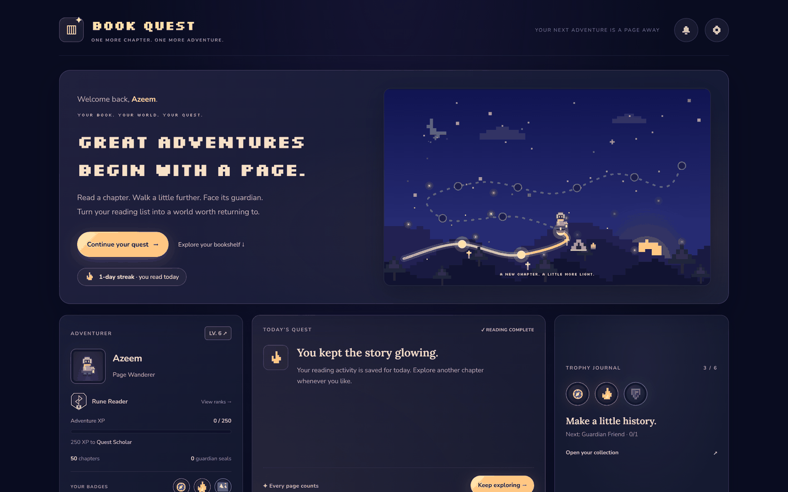
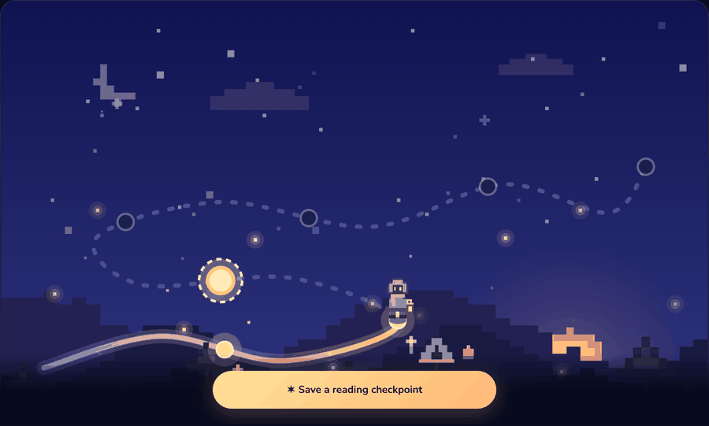
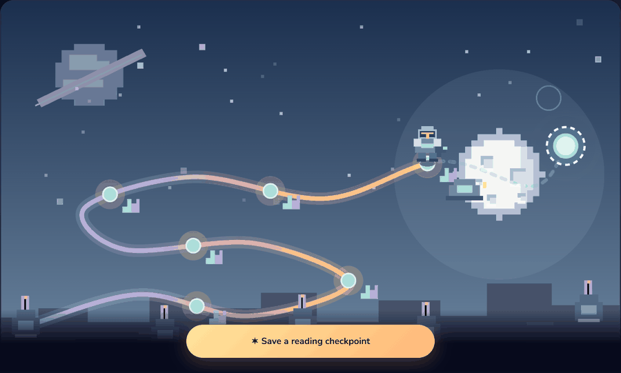
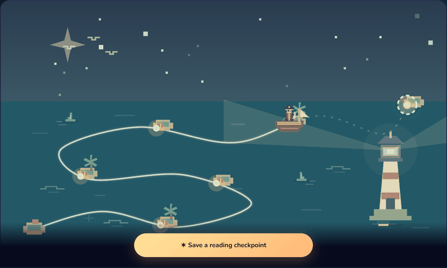
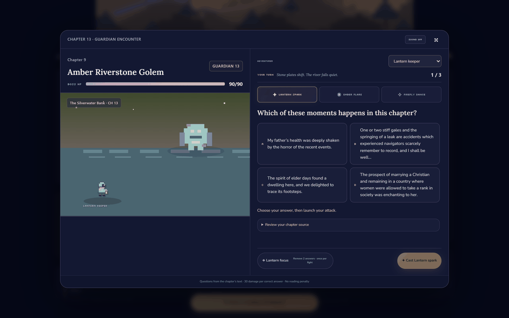
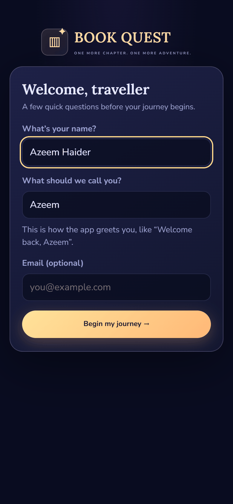
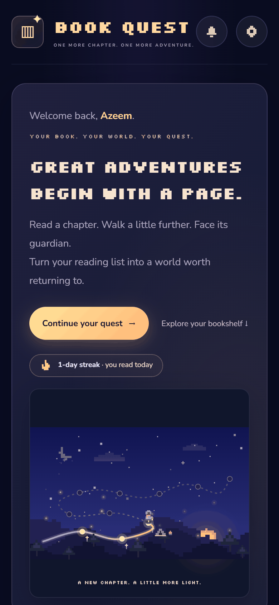
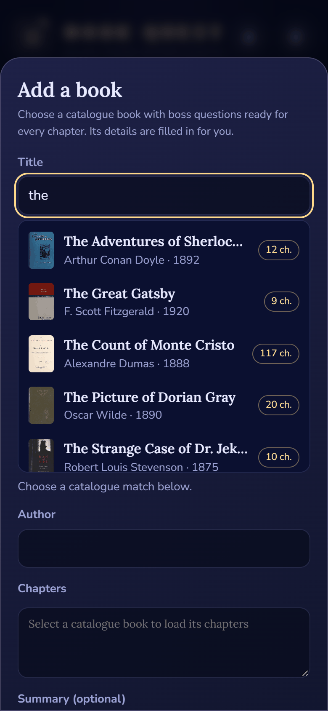

# Book Quest

**One more chapter. One more adventure.**

Book Quest is a reading companion that turns the book you're reading into a pixel-art journey. Every chapter you finish moves your character further along a map. Each chapter has a guardian to beat by answering questions about what you just read. If you drift away, the app reminds you where you were and welcomes you back.



---

## The problem

Most people who start a book don't finish it. They rarely quit on purpose. Life gets busy, a few days become a few weeks, and picking the book back up means remembering who everyone is and what was happening. That feels like work, so the book stays on the nightstand.

Existing reading apps mostly *track* reading: page counts, goals, shelves. They record that you stopped, but do little to help you start again, and nothing makes the next chapter feel rewarding.

## Our solution

Book Quest focuses on the two moments that decide whether a book gets finished: **keeping momentum** and **coming back after a break**.

| The problem | How Book Quest helps |
| --- | --- |
| Reading feels like a chore with no visible progress | Each chapter is a stop on a pixel-art map. Your character walks there and the sky brightens as you near the end. |
| Nothing confirms you took the chapter in | Each chapter has a **guardian battle**: three questions about that chapter, answered to power your attacks. |
| After a break you forget the story | **"Where was I?"** gives a short, spoiler-safe recap of the story so far, woven together with your own notes. |
| Books quietly get abandoned | Gentle **reminders** at 2 days, 1 week, 2 weeks, 1 month and 6 months, delivered as phone or desktop push notifications. |
| Setting up a book is tedious | Type a title and pick from the **catalogue**. The author, summary and full chapter list fill in automatically. |

---

## Features

### Your book becomes a journey, in the world you choose
Every book gets its own map with one stop per chapter. Choose a **Fantasy**, **Sci-fi** or **Pirates** world for each book, and pick from four companions per world, each with their own attacks. The sun rises in Fantasy, the moon rises in Sci-fi, and the lighthouse grows brighter in Pirates as you read further.

| Fantasy | Sci-fi | Pirates |
| :---: | :---: | :---: |
|  |  |  |

### Guardian battles that check you read the chapter
Finishing a chapter unlocks its guardian. Answer three questions about the chapter. Each correct answer powers an attack, and three correct answers win you the chapter's seal. Wrong answers are never penalised: you just try again.



The questions come from the chapter's **actual text**, not from an AI guessing. See [Where the questions come from](#where-the-questions-come-from).

### Built for phones
Book Quest is a mobile-first web app that can be installed to the home screen (a PWA). Sign-up takes three fields, and adding a book is a search.

| Sign up | Your bookshelf | Add a book |
| :---: | :---: | :---: |
|  |  |  |

### Everything else
- **"Where was I?" recaps.** A short AI-written summary of the story so far that never goes past your current chapter, combined with your own chapter notes. It is written in the background when you save a checkpoint, so it's ready when you come back.
- **Reminders that back off.** One nudge at each step of 2 days, 1 week, 2 weeks, 1 month and 6 months, written in a warm tone and addressed to you by name. Any reading resets the schedule.
- **Streaks, XP, ranks and badges.** Progress you can see, with no punishment for missing a day.
- **Notes.** Notes on a chapter feed into your recaps; general notes stay yours.
- **Find my next quest.** A six-question guide that suggests your next book from the catalogue.
- **Private accounts.** Each reader signs up and sees only their own shelf.

---

## Where the questions come from

The trust problem with AI quizzes is that the AI can make up facts. Book Quest's core questions use **no AI at all**:

1. The full public-domain text of each classic is downloaded from **Project Gutenberg**.
2. Our chapter detector splits the text into chapters, so the questions line up with the catalogue's chapter list.
3. A rule-based generator writes three questions per chapter:
   - **"Which of these moments happens in this chapter?"** The right answer is a real sentence from the chapter. The wrong answers are real sentences from *other* chapters of the same book.
   - **Fill in the missing name.** A real sentence with a character's name blanked out. The other options are characters from the same book, so the type of answer doesn't give it away.

That gives **3,342 questions across 20 classics**, all bundled with the app. When an AI model is used to add extra questions, every answer must come with an exact quote from the chapter; otherwise it's discarded.

**Where the catalogue data comes from:** book details come from Open Library and Wikipedia, and texts and chapter lists come from Project Gutenberg. None of it is generated by AI.

---

## How it works

```
 Phone / laptop browser                  Flask API                       Data & services
┌──────────────────────┐   HTTPS     ┌───────────────────────┐     ┌──────────────────────────┐
│ Vanilla JS web app   │ ──────────▶ │ accounts (device key) │ ──▶ │ SQLite (local) or        │
│ PWA + service worker │ ◀────────── │ books, checkpoints    │     │ Postgres on Tiger Data   │
│ pixel-art maps (SVG) │  Web Push   │ catalogue + questions │ ──▶ │ Open Library, Gutenberg, │
└──────────────────────┘ ◀───────────│ reminder scheduler    │     │ Wikipedia                │
                                     │ AI recaps (fallbacks) │ ──▶ │ Gemini / OpenRouter      │
                                     └───────────────────────┘     └──────────────────────────┘
```

- **Frontend:** plain HTML, CSS and JavaScript with no framework, in [`src/frontend`](src/frontend). The maps, characters and bosses are drawn in code as SVG pixel art.
- **Backend:** Python and Flask, in [`src/backend`](src/backend). It uses plain SQL that runs on SQLite locally and on hosted **PostgreSQL (Tiger Data)** in production, switched by one setting.
- **Accounts:** sign-up gives each device a private key. The server stores only a hash of it, and every reader sees only their own data.
- **Notifications:** standard **Web Push** (VAPID), so reminders reach the lock screen even when the app is closed.
- **AI:** used only for recaps, reminder wording and recommendations. If the model is unavailable, it falls back through several models and then to template text, so the app always works.

---

## Run it locally

You need **Python 3.11+** and **Node.js 18+**.

```bash
# 1. Backend: http://localhost:5000
cd src/backend
pip install -r requirements.txt
python -m flask --app app run --port 5000

# 2. Frontend: http://localhost:5173 (in a second terminal)
cd src/frontend
npm start
```

Open **http://localhost:5173**, sign up, and add a book from the catalogue.

### Configuration (optional)
Copy [`src/backend/.env.example`](src/backend/.env.example) to `src/backend/.env`. Everything is optional:

| Setting | What it does | Without it |
| --- | --- | --- |
| `GEMINI_API_KEY` (or `OPENROUTER_API_KEY`) | AI recaps, reminder wording and recommendations | Template text is used instead |
| `DATABASE_URL` | Use hosted Postgres (for example Tiger Data) | A local SQLite file in `src/backend/data/` |

`.env` and the local database are git-ignored. Never commit real keys.

### Tests

```bash
cd src/backend && python -m pytest     # API, accounts, catalogue, questions, notifications
cd src/frontend && npm test            # game engine, battles, maps, characters, progress
```

---

## Project structure

```
src/
  frontend/              web app (PWA)
    js/app.js            screens: sign-up, bookshelf, book page, settings
    js/boss-battle.js    guardian battles
    js/journey.js        pixel-art journey maps and characters
    js/store.js          API client
    sw.js                service worker (offline shell + push notifications)
  backend/               Flask API
    app.py               routes and CLI commands
    db.py                SQLite / Postgres layer
    catalog.py           book catalogue (Open Library, Gutenberg, Wikipedia)
    questions.py         rule-based question generator
    summaries.py         "Where was I?" recaps
    notifications.py     reminder schedule and Web Push
    catalog_data/        bundled catalogue and 3,342 questions
docs/
  screenshots/           images used in this README
  technical-notes.md     detailed notes on every feature
```

## Limitations and next steps
- **One device per account.** Signing in on a second device needs email sign-in, which is planned.
- **Catalogue size.** The catalogue currently offers 20 public-domain classics with full question coverage. Modern books (for example Dune or The Lord of the Rings) need AI-written questions, which are still being filled in.
- **Self-reported reading.** The guardian questions encourage reading, but the app can't prove you read a chapter.

For the full detail of each feature, see [docs/technical-notes.md](docs/technical-notes.md).

## License
[MIT](LICENSE)
